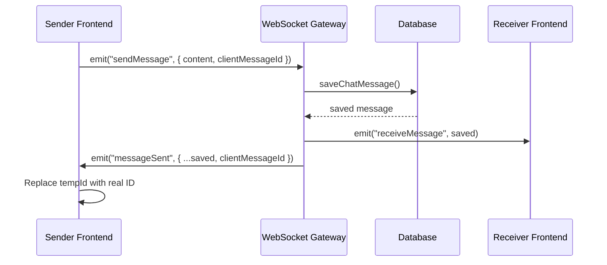

# MOA Portal Chat App - Improvement Plan

## Current Architecture Overview

### Tech Stack
- **Frontend**: Next.js 14 (React) with Socket.io-client, running on port 3000
- **Backend**: NestJS with Socket.io, Drizzle ORM, PostgreSQL, running on port 4000
- **Auth**: JWT-based (access + refresh tokens), sessions managed via cookies
- **Real-time**: Socket.io WebSocket gateway at [`ChatGateway`](../apps/server/src/modules/chat.gateway.ts:12)
- **Database**: PostgreSQL with tables: `users`, `chat_messages`, `chat_rooms`, `chat_room_members`, `notifications`, `notification_preferences`
- **File Upload**: Multer middleware, stored in [`public/uploads/`](../apps/server/public/uploads)

### Key Files
| File | Purpose |
|------|---------|
| [`apps/server/src/modules/chat.gateway.ts`](../apps/server/src/modules/chat.gateway.ts) | WebSocket event handlers (send, edit, delete messages, typing, reactions) |
| [`apps/server/src/modules/chat.controller.ts`](../apps/server/src/modules/chat.controller.ts) | REST endpoints for history, rooms, uploads, notifications |
| [`apps/server/src/db/database.service.ts`](../apps/server/src/db/database.service.ts) | All database operations for chat |
| [`apps/shell/src/app/chat/page.tsx`](../apps/shell/src/app/chat/page.tsx) | Main chat UI component (~1393 lines, single-file SPA) |
| [`apps/shell/src/app/chat/ProfileModal.tsx`](../apps/shell/src/app/chat/ProfileModal.tsx) | Profile modal (view-only, no edit) |
| [`packages/shared/src/db/index.ts`](../packages/shared/src/db/index.ts) | DB schema definitions (Drizzle) |

### Critical Gaps Identified

1. **Double message saving**: Frontend `sendMsg()` calls REST POST `/api/chat/messages` AND emits `sendMessage` via socket. The gateway `handleMessage` also saves to DB. Messages are saved twice.
2. **Missing `voiceDuration` column**: The `chat_messages` table has no `voice_duration` column. Voice duration data is never persisted.
3. **No per-conversation unread counts from server**: The frontend tracks unread counts client-side only via `unreadCountsRef`. Server has no query for per-conversation unread counts.
4. **Audio playback doesn't track progress**: The voice player shows a static "100%" progress bar without actual time tracking.
5. **Profile modal lacks edit capability**: No way to change name, avatar, or password.

---

## Implementation Tasks

### Task 1: Fix Real-Time Messaging (Double-Save & Reliability)

#### Problem
The frontend `sendMsg()` at [`line 520`](../apps/shell/src/app/chat/page.tsx:520) calls REST POST `/api/chat/messages` AND emits `sendMessage` via WebSocket. The gateway's `handleMessage` at [`line 63`](../apps/server/src/modules/chat.gateway.ts:63) also saves to DB. This causes every message to be saved twice.

Additionally, the REST POST returns a saved message that replaces the optimistic tempId, but the subsequent socket `messageSent` event does the same replacement, causing race conditions.

#### Solution
**Option A (Recommended):** Remove the REST POST from `sendMsg()`. Use WebSocket exclusively for sending messages. The gateway already saves to DB and broadcasts. Keep REST endpoints only for history loading.

**Changes needed:**
1. [`apps/shell/src/app/chat/page.tsx`](../apps/shell/src/app/chat/page.tsx): Modify `sendMsg()` - remove the `fetch("/api/chat/messages", { method: "POST" ... })` block. Keep only the socket emission and optimistic UI with tempId.
2. [`apps/shell/src/app/chat/page.tsx`](../apps/shell/src/app/chat/page.tsx): In the `messageSent` socket handler (line 255), ensure the tempId → real ID replacement is atomic and race-condition-free.
3. [`apps/server/src/modules/chat.gateway.ts`](../apps/server/src/modules/chat.gateway.ts): In `handleMessage`, also include the `clientMessageId` in the response payload so the sender can match it.

#### Sequence Diagram


---

### Task 2: Add `voiceDuration` Column & Persist Voice Metadata

#### Problem
The `chat_messages` table has no `voice_duration` column. The frontend's `Message` interface includes `voiceDuration?: number` but it's never stored or retrieved from the DB. Existing voice messages always show "00:00".

#### Changes needed:
1. [`packages/shared/src/db/index.ts`](../packages/shared/src/db/index.ts): Add `voiceDuration: integer("voice_duration")` column to `chatMessages` table.
2. Create Drizzle migration file for the new column.
3. [`apps/server/src/db/database.service.ts`](../apps/server/src/db/database.service.ts): Update `saveChatMessage()` to accept and store `voiceDuration`.
4. [`apps/server/src/modules/chat.gateway.ts`](../apps/server/src/modules/chat.gateway.ts): Update `handleMessage` and `handleForwardMessage` to pass `voiceDuration` to `saveChatMessage`.
5. [`apps/server/src/modules/chat.controller.ts`](../apps/server/src/modules/chat.controller.ts): Update `sendMessage` REST endpoint to accept `voiceDuration` (for backward compatibility).
6. [`apps/shell/src/app/chat/page.tsx`](../apps/shell/src/app/chat/page.tsx): Ensure `voiceDuration` is included in all relevant WebSocket and REST payloads.

#### Migration Script
Create a new migration file `0004_add_voice_duration.sql`:
```sql
ALTER TABLE chat_messages ADD COLUMN voice_duration integer;
```

---

### Task 3: Fix Voice Memo Playback - Proper Progress Tracking

#### Problem
The voice player at [`line 1039`](../apps/shell/src/app/chat/page.tsx:1039) has a progress bar that always shows 100% when playing. The duration display only shows `msg.voiceDuration` which is always 0 (never persisted). There's no `timeupdate` event listener to track playback progress.

#### Solution
Replace the simple `<audio>` element approach with a proper state-managed player:

1. [`apps/shell/src/app/chat/page.tsx`](../apps/shell/src/app/chat/page.tsx): Add state variables:
   - `voiceProgress: { [msgId: string]: { currentTime: number; duration: number } }`
   - Replace `voicePlayingId` with a richer state
   
2. Implement proper `<audio>` element with event listeners:
   - `timeupdate` → update current time and progress bar width
   - `loadedmetadata` → set total duration
   - `ended` → reset state

3. Show proper Telegram-style player:
   - Play/pause button
   - Progress bar (actual percentage based on currentTime/duration)
   - Display: "currentTime / totalTime" (e.g., "01:24 / 01:24")

4. Use a hidden `<audio>` element per message or a shared one with state tracking.

---

### Task 4: Fix Per-Conversation Unread Badge Counts

#### Problem
Currently, unread badges are tracked client-side via `unreadCountsRef` at [`line 89`](../apps/shell/src/app/chat/page.tsx:89). When a new message arrives for a non-active conversation, the count is incremented. But:
- The server stores notification records but doesn't track per-conversation unread counts
- When page is refreshed, all unread counts are lost
- The "badge" property on `Conversation` interface is never populated from server data

#### Solution
Add server-side per-conversation unread message tracking:

1. [`apps/server/src/db/database.service.ts`](../apps/server/src/db/database.service.ts): Add methods:
   - `getUnreadMessageCount(userId: string)`: Returns map of conversationId → unread count
   - `markConversationRead(userId: string, conversationId: string)`: Marks messages as read
   
2. [`apps/server/src/modules/chat.controller.ts`](../apps/server/src/modules/chat.controller.ts): Add REST endpoints:
   - `GET /api/chat/unread-counts` → returns per-conversation unread counts
   - `PUT /api/chat/conversations/:id/read` → marks conversation as read
   
3. [`apps/server/src/modules/chat.gateway.ts`](../apps/server/src/modules/chat.gateway.ts): When a message is sent, increment unread count for all recipients except sender.

4. [`apps/shell/src/app/chat/page.tsx`](../apps/shell/src/app/chat/page.tsx): 
   - On initial load, fetch unread counts from server
   - On conversation click, mark it as read and reset badge
   - Display badge count correctly (currently uses `conv.badge` which is never set)

#### Approach Without Schema Changes
Since the `chat_messages` table already has `createdAt` and `senderId`, we can compute unread counts by tracking `last_read_at` per user per conversation. Add a `chat_conversation_read_status` table:
- `userId`, `conversationId` (either a userId for DMs or roomId), `lastReadAt`

Or simpler: add `lastReadAt` to `chatRoomMembers` for rooms, and create a similar tracking for DMs.

Actually, the simplest approach that avoids schema changes: track the last message ID the user has seen per conversation in a simple client-side + server-side approach using notifications. But since notifications are already stored, let's use a simpler approach:

**Simpler Approach:** Add `last_read_at` to `chat_room_members` for rooms, and create a new table `chat_direct_read_status` for DMs. Or even simpler - just add `read` boolean or `readAt` timestamp to `chat_messages`. But that would require updating every message in a conversation when read.

**Simplest Approach:** Use the `notifications` table which already tracks per-notification read status. Since each message generates a notification for the recipient, the unread notification count for messages of a specific type gives us the per-conversation unread count. We'd need to track the `senderId` or `roomId` in the notification `data` field.

Actually, the cleanest: Add a new database table `chat_message_read_status` with `userId, messageId, readAt`. Or even simpler - just compute it on the fly from the messages table:

```sql
SELECT COUNT(*) FROM chat_messages 
WHERE receiverId = $userId AND readAt IS NULL AND deletedAt IS NULL
```

But that requires a `readAt` column on `chat_messages`. Let's go with this approach - it's the simplest.

Add `readAt: timestamp("read_at")` to `chat_messages` table. When opening a conversation, update `readAt` for all messages in that conversation.

Actually the `chat_messages` table is a single table shared by all conversations. The "read" status should be per-user-pair or per-room.

Let me think about a cleaner approach... 

For groups/channels, we can add `lastReadAt` to `chat_room_members`.
For direct messages, we can add a new `chat_direct_read_status(userId, otherUserId, lastReadAt)` table.

This is the cleanest approach.

---

### Task 5: Update Message Colors for Sender/Receiver

#### Problem
Current colors at [`line 1029`](../apps/shell/src/app/chat/page.tsx:1029):
- Sender: `bg-[#1a7f5c] text-white`  
- Receiver: `bg-[#f1f5f9] text-[#1e293b]`

User wants:
- Sender: `bg-[#dcf8c5]` (light green) or `bg-[#e1ffc7]`
- Receiver: `bg-[#ffffff]` or `bg-[#f1f0f0]`

#### Changes needed
1. [`apps/shell/src/app/chat/page.tsx`](../apps/shell/src/app/chat/page.tsx): Change the message bubble classes at line 1029:
   - Sender: change `bg-[#1a7f5c] text-white rounded-br-[4px]` to `bg-[#dcf8c5] text-[#1e293b] rounded-br-[4px]`
   - Receiver: change to `bg-white text-[#1e293b] rounded-bl-[4px] border border-[#e2e8f0]`

2. Ensure all message types (text, voice, images, files) inherit these colors.

---

### Task 6: Add Browser Notifications for New Messages

#### Problem
The frontend already requests notification permission at [`line 228`](../apps/shell/src/app/chat/page.tsx:228) and shows notifications at [`line 248`](../apps/shell/src/app/chat/page.tsx:248), but the notification title is always "New message" instead of "New message from [sender name]".

#### Changes needed
1. [`apps/shell/src/app/chat/page.tsx`](../apps/shell/src/app/chat/page.tsx): Update the `receiveMessage` handler to include sender name in notification:
   - Get sender name from `allUsers` or `getSenderName()`
   - Set notification title to `New message from ${senderName}`
   - Set notification body to message preview

2. Update the tab title with unread count badge using `document.title`.

3. Ensure notifications fire only when:
   - The app is in the background (`document.visibilityState !== "visible"`)
   - Notification permission is granted
   - The conversation is not the active one

---

### Task 7: Add Current User Profile Edit Functionality

#### Problem
Clicking the profile icon at [`line 887`](../apps/shell/src/app/chat/page.tsx:887) opens `ProfileModal` with the current user's ID. The modal at [`ProfileModal.tsx`](../apps/shell/src/app/chat/ProfileModal.tsx) only shows info - no edit capability.

#### Solution
Create a new "My Profile" experience:

1. **New endpoint**: `PUT /api/chat/profile` for updating current user's profile (name, password, avatar).

2. **Enhanced Profile Modal**: When viewing own profile, show edit buttons:
   - Edit name (text input)
   - Upload new avatar (file upload to `/api/chat/upload`, then update user's avatarUrl in users table... but there's no avatarUrl field on users table!)
   
   **Schema change needed**: Add `avatarUrl: text("avatar_url")` to `users` table.

3. **Update `ProfileModal.tsx`**: 
   - Check if `userId === currentUser.id` → show "Edit Profile" mode
   - If edit mode, show form fields for fullName, avatar upload
   - Add password change option
   - On save, call PUT `/api/chat/profile` with form data

4. **Update `database.service.ts`**: Add `updateCurrentUserProfile(userId, { fullName?, avatarUrl?, password? })` method.

5. **Update `chat.controller.ts`**: Add `PUT /api/chat/profile` endpoint.

6. **Sidebar avatar**: Show the current user's avatar (from `currentUser` state or a gravatar-like URL) in the sidebar profile icon.

---

### Task 8: Database Schema Changes Summary

#### New Migration: `0004_add_chat_features.sql`

```sql
-- 1. Add voice_duration to chat_messages
ALTER TABLE chat_messages ADD COLUMN voice_duration integer;

-- 2. Add last_read_at to chat_room_members for group read tracking
ALTER TABLE chat_room_members ADD COLUMN last_read_at timestamp;

-- 3. Create direct message read status table
CREATE TABLE chat_direct_read_status (
  user_id uuid NOT NULL REFERENCES users(id) ON DELETE CASCADE,
  other_user_id uuid NOT NULL REFERENCES users(id) ON DELETE CASCADE,
  last_read_at timestamp NOT NULL DEFAULT now(),
  PRIMARY KEY (user_id, other_user_id)
);

-- 4. Add avatar_url to users table
ALTER TABLE users ADD COLUMN avatar_url text;

-- 5. Add unread_count to notifications model
ALTER TABLE notifications ADD COLUMN conversation_id text;
ALTER TABLE notifications ADD COLUMN sender_name text;
```

#### Update Drizzle schema in [`packages/shared/src/db/index.ts`](../packages/shared/src/db/index.ts):
```typescript
// Add to chatMessages
voiceDuration: integer("voice_duration"),

// Add to chatRoomMembers
lastReadAt: timestamp("last_read_at"),

// New table
export const chatDirectReadStatus = pgTable("chat_direct_read_status", {
  userId: uuid("user_id").references(() => users.id).notNull(),
  otherUserId: uuid("other_user_id").references(() => users.id).notNull(),
  lastReadAt: timestamp("last_read_at").defaultNow().notNull(),
}, (table) => ({
  pk: primaryKey({ columns: [table.userId, table.otherUserId] }),
}));

// Add to users
avatarUrl: text("avatar_url"),
```

---

## Implementation Order

Each task should be implemented in the order listed above to minimize merge conflicts and ensure dependencies are satisfied:

1. **Task 1**: Fix real-time messaging (critical foundation)
2. **Task 8**: Database schema changes (needed by Tasks 2, 4, 7)
3. **Task 2**: Voice duration persistence (depends on Task 8)
4. **Task 3**: Voice player fix (depends on Task 2)
5. **Task 4**: Unread counts (depends on Task 8)
6. **Task 5**: Message colors (standalone)
7. **Task 6**: Browser notifications (standalone)
8. **Task 7**: Profile edit (depends on Task 8)

---

## Testing Instructions

### Test 1: Real-Time Chat
1. Open two browser tabs, log in as different users (e.g., "Administrator" and "Field Supervisor")
2. In Tab 1, open a direct conversation with Tab 2's user
3. Send a message from Tab 1 → it should appear instantly in Tab 2 without refresh
4. Verify no duplicate messages appear

### Test 2: Voice Memo
1. Record a voice memo (click microphone icon)
2. After sending, verify the duration is displayed correctly (e.g., "01:24 / 01:24")
3. Click play → verify progress bar moves with playback
4. Test on a different browser tab → verify duration persists

### Test 3: Unread Badges
1. User A sends messages to User B while User B is in a different conversation
2. User B's sidebar should show a red badge with unread count on User A's conversation
3. Click User A's conversation → badge should reset to 0
4. Verify after page refresh, unread counts are restored from server

### Test 4: Message Colors
1. Send a message → verify sender bubble has light green background (`#dcf8c5`) and is right-aligned
2. Receive a message → verify receiver bubble has white background (`#ffffff`) and is left-aligned
3. Verify voice, image, and file messages follow the same color scheme

### Test 5: Browser Notifications
1. Open the chat in Tab 1
2. Switch to Tab 2 (different app) or minimize browser
3. Have another user send a message
4. Verify a system notification appears with "New message from [sender name]"
5. Verify tab title shows unread count badge

### Test 6: Profile Edit
1. Click the profile icon in the sidebar
2. Verify it opens the current user's profile
3. Click "Edit Profile" → change name, upload avatar
4. Save → verify changes appear immediately in sidebar and profile
5. Click another user's avatar in chat → verify their profile still shows (not your own)
